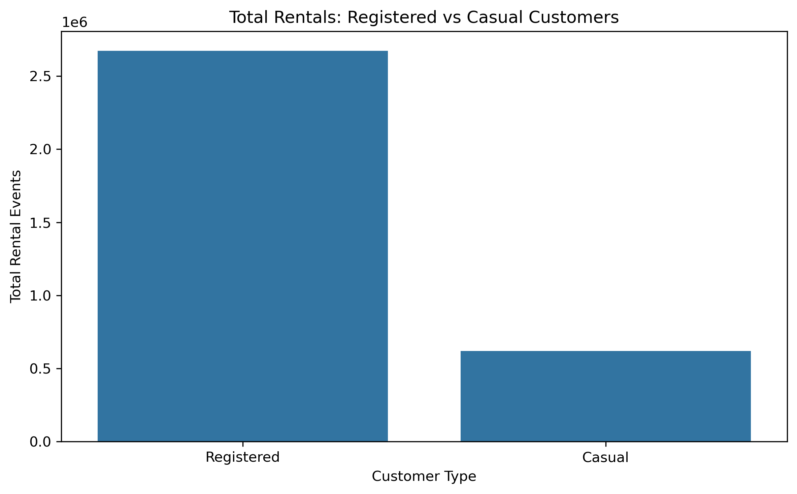

# Bike Sharing Demand Analysis

## Project Overview

This project explores bike-sharing rental demand using the UCI Bike Sharing Dataset.

The goal is to understand how factors such as time of day, working days, seasons, weather conditions, and temperature relate to bike rental activity.

The analysis uses Python and data visualisation libraries to identify patterns and generate business insights.

## Objectives

- Explore hourly bike rental demand.
- Analyse rental patterns across different hours and working days.
- Investigate seasonal and weather-related trends.
- Examine the relationship between temperature and rental demand.
- Compare registered and casual customer rental activity.

## Dataset

**Source:** [UCI Machine Learning Repository – Bike Sharing Dataset](https://archive.ics.uci.edu/dataset/275/bike+sharing+dataset)

The hourly dataset contains:

- 17,379 observations
- 17 columns
- Rental information from Washington, D.C. bike-sharing operations

The target variable is `cnt`, representing the total number of bike rentals per hour.

## Tools and Technologies

- Python
- Pandas
- NumPy
- Matplotlib
- Seaborn
- Jupyter Notebook

## Project Structure

```text
bike-sharing-demand-analysis/
│
├── data/
│   ├── raw/
│   └── processed/
│       └── cleaned_bike_data.csv
│
├── notebooks/
│   └── bike_sharing_analysis.ipynb
│
├── reports/
│   └── figures/
│       └── user_type_comparison.png
│
├── .gitignore
├── requirements.txt
└── README.md
```

## Key Findings

1. **Hourly demand:** Bike rental activity varies throughout the day, with identifiable peak hours.

2. **Working-day patterns:** Rental demand shows different patterns between working days and non-working days.

3. **Seasonality:** Rental activity varies across seasons, with fall showing the highest average demand in the analysis.

4. **Weather conditions:** Clear weather is associated with higher average rental demand than adverse weather conditions.

5. **Temperature:** Temperature has a moderate positive correlation with rental demand (approximately 0.405).

6. **Customer segments:** Registered customers account for 81.17% of rental events, while casual customers account for 18.83%.

## Visualisation

### Registered vs Casual Customers



## Business Recommendations

- Explore membership incentives to convert casual customers into registered members.
- Consider hourly demand patterns when planning bike availability.
- Account for seasonal and weather-related changes when planning operations.

## How to Run This Project

1. Clone this repository.
2. Navigate to the project directory.
3. Create and activate a Python virtual environment.
4. Install dependencies:

```bash
pip install -r requirements.txt
```

5. Launch Jupyter Notebook:

```bash
jupyter notebook
```

6. Open `notebooks/bike_sharing_analysis.ipynb`.

## Author

Created as a data analytics portfolio project using Python.

